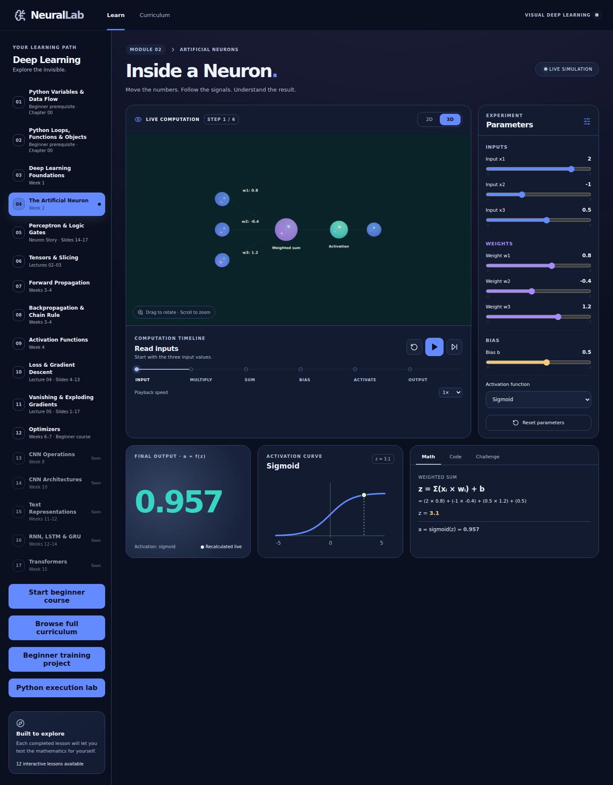
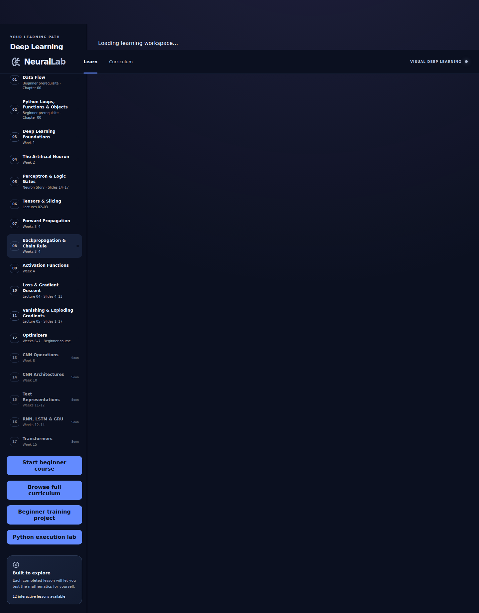
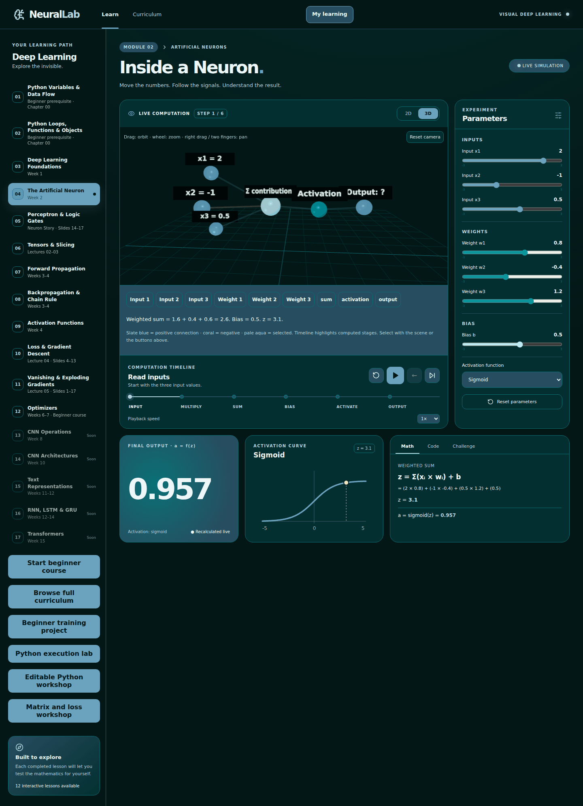
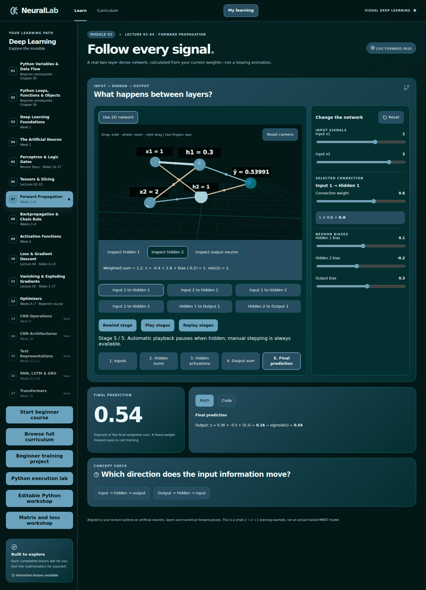
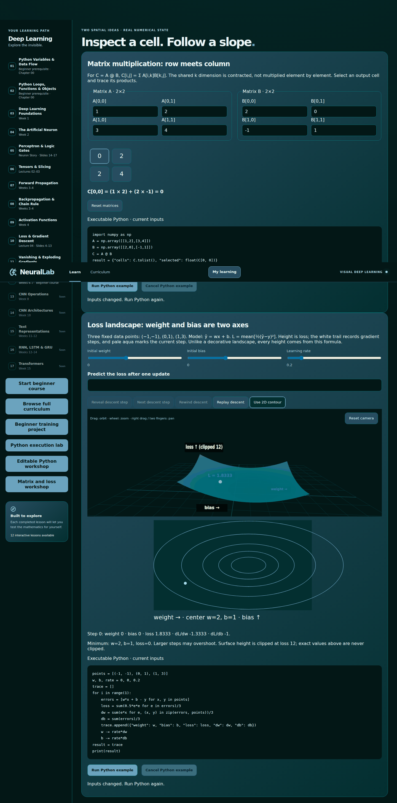
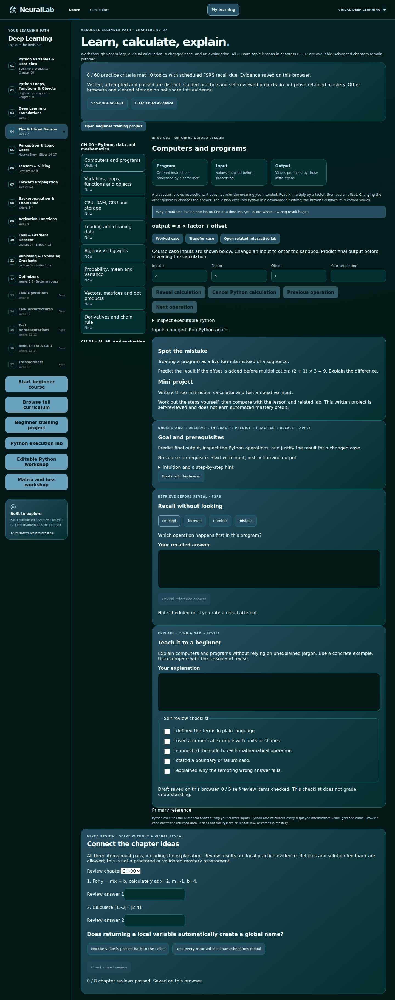
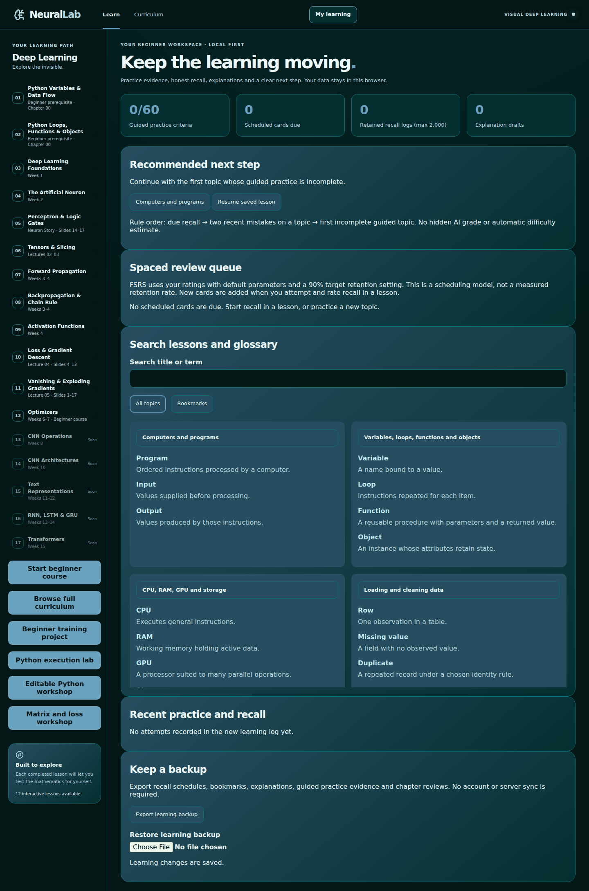
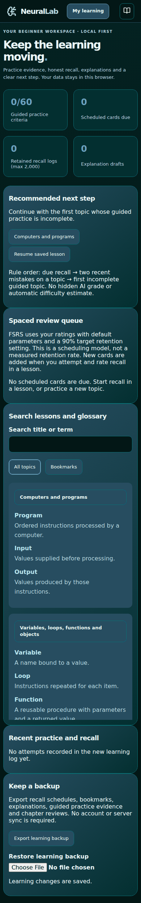

# Visualization review

## Before

The original neuron scene used a green background, nearly coplanar spheres, narrow weight lines and small labels. Pan was disabled. There was no selectable numerical inspector in 3D. The original forward and backward SVGs were useful and have been retained.

## After

- Shared deep-teal scene frame, floor grid, depth-separated nodes, larger labels and positive/negative/selected colors.
- Neuron and edge selection through meshes and accessible DOM buttons. The inspector shows current inputs, products, sum, bias, z and activation output.
- Orbit, zoom, pan and camera reset. Demand rendering pauses offscreen or with a hidden document; DPR can decline to 1. No continuous decorative animation is required.
- Layered 2–2–1 scene in the existing forward and backward labs. All numbers, controls and gradients reuse their existing tested numerical state. Training still executes Python before applying the returned update.
- Playback, pause, rewind and replay are available for computation stages. The visible stage and numerical trace describe the same state.
- Mathematical 3D loss surface: actual mean half-squared error over a fixed dataset; axes are weight, bias and loss. A matching contour and exact inspector remain available. Surface height is clipped at 12, as labeled; exact loss is not clipped.
- Matrix output cells are selectable with a mouse or keyboard. Each cell exposes the actual contracted row/column products and can be checked with NumPy.
- 2D is the initial neuron view on small screens and for reduced motion. Every 3D flow retains a 2D alternative; WebGL absence does not block the course.

Screenshots are reproducible with `node scripts/capture-beginner.mjs`. Desktop viewport: 1440×1000; mobile: 390×844. They demonstrate rendered layout and actual WebGL appearance in Chromium, not a claim of frame-rate performance on every device. Unit finite-difference checks independently validate the surface derivatives. Scene-switch browser checks verify only one live canvas and absence of runtime errors; a long-duration heap benchmark has not been performed.

## Requested palette

Applied the supplied six-color palette: `#031716` background, `#032F30` surfaces, `#274D60` panels, `#0A7075` borders/grid, `#0C969C` teal interaction and `#6BA3BE` slate-blue inputs. Light text/selection and coral error indicators remain for readable contrast and signed-value distinction. Updated the shared 3D canvas, 2D input paths and charts alongside CSS tokens; refreshed all six after screenshots.
